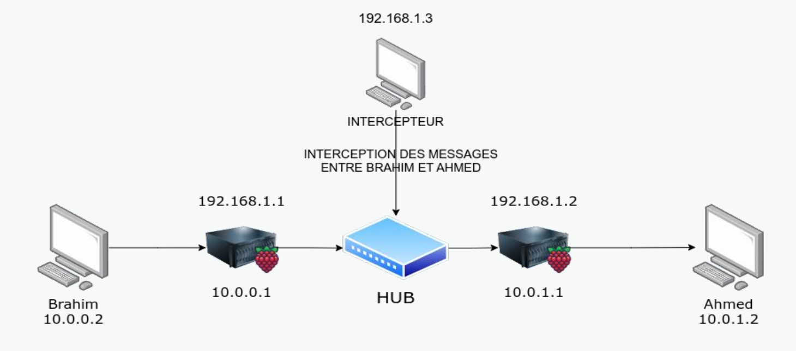
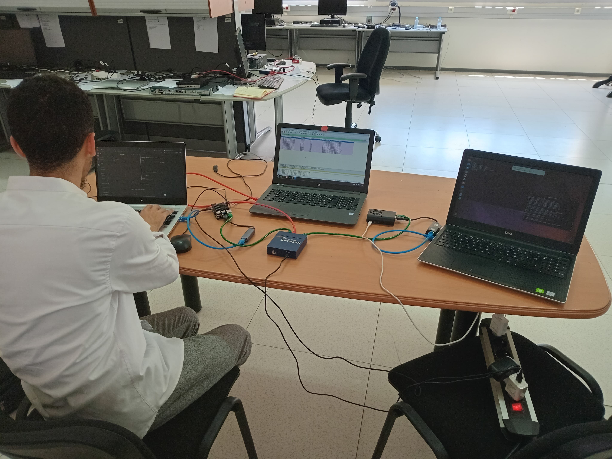
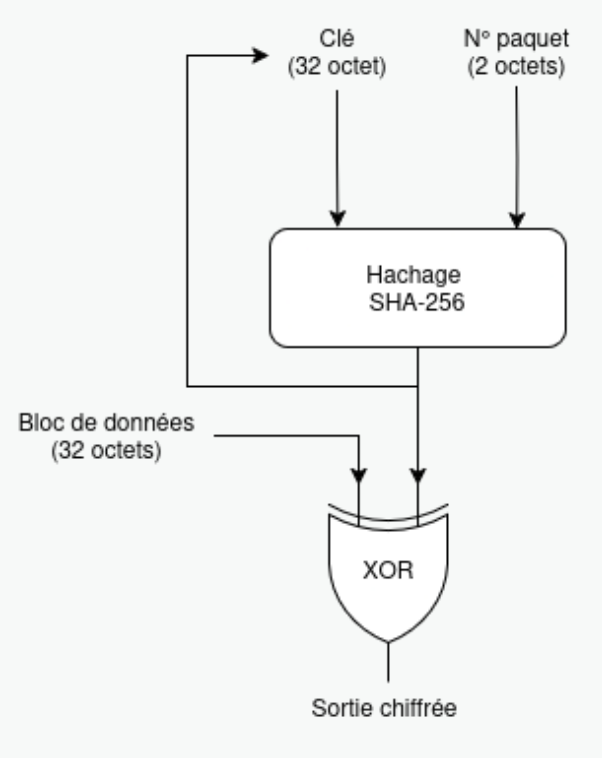
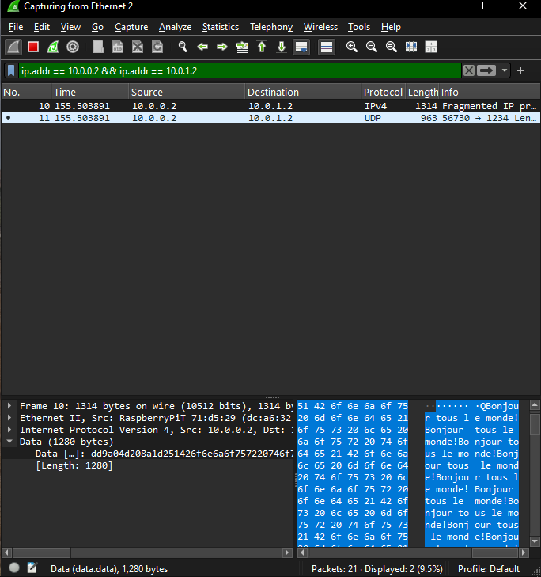
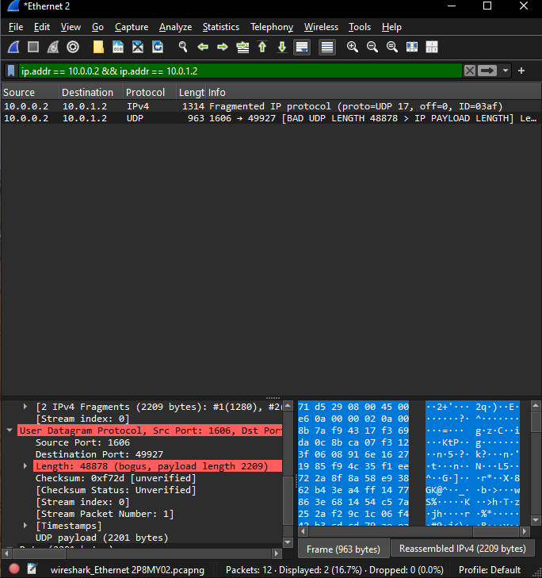
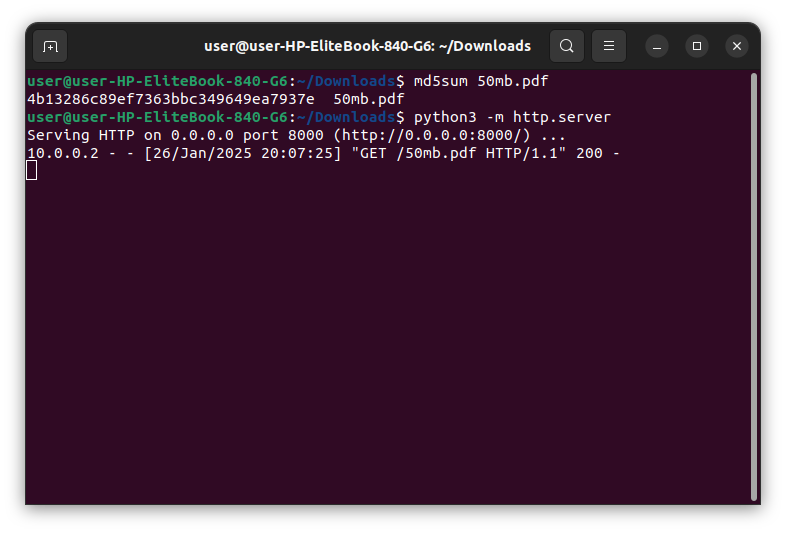
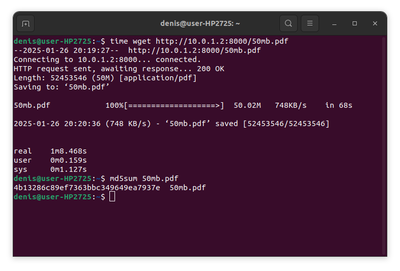

# tipe-kernel-cryptor — Inline Netfilter Packet Encryption

A Linux Kernel Module (LKM) for inline IPv4 packet encryption using Netfilter hooks.

Academic project developed for the CPGE TIPE examinations (French Concours & Moroccan CNC 2025, Academic Year 2024/2025).

---

## Project Context

- **Subject**: IP Packet Encryption: Securing Information Sharing
- **Author**: Haitam Lazaar
- **Examination**: French Engineering Entrance Exams (Concours Français) & Moroccan CNC (2025 Session)
- **Academic Year**: 2024/2025
- **Official National Theme**: *Transition, transformation, conversion*

### How This Started & My Approach

When the national TIPE theme was announced as “Transition, transformation, conversion”, I didn’t want to write another dry paper on abstract algebra or theoretical math. I had already spent time reading kernel code and hacking together basic Linux kernel modules in my spare time, so I wanted to tackle a real networking problem from the ground up.

In an enterprise environment, securing internal traffic—like VoIP streams, video calls, or sensitive file transfers—against an attacker on the local network usually means forcing client machines to install dedicated VPN software or configuring heavy IPsec overlays. I wanted to explore a different angle: transparent, inline payload encryption at the gateway level. The idea was to leave the outer IP headers intact for standard routing while transforming the payload on-the-fly, making the data completely illegible to anyone eavesdropping on the transit segment without requiring any configuration on client devices.

This defined the core research question I set out to investigate:

> **“How can IP packets be encrypted within an enterprise network to guarantee confidentiality, integrity, and performance?”**

It wasn’t just about scrambling bytes; it had to satisfy all three constraints at once:

- **Confidentiality:** Scrambling the payload on the wire so an attacker with Wireshark sees nothing useful.
- **Integrity:** Ensuring the cipher and network headers remain valid so the receiving gateway can decrypt the exact original data without bit corruption or dropped packets.
- **Performance:** Keeping processing overhead low enough on lightweight hardware (like a Raspberry Pi gateway) to handle real-time traffic without choking.

To evaluate this under real network conditions, I adopted an iterative two-phase methodology:

1. **Phase 1: User-Space Python Prototype (`NetfilterQueue`)**  
   I first built a prototype running in user space on a dual-interface Raspberry Pi. While packet captures in Wireshark proved that inline payload encryption successfully scrambled data on the wire, benchmarking exposed clear bottlenecks: high CPU utilization, context-switching overhead, and throughput drops during large file transfers.
   
2. **Phase 2: Transition to C Kernel Space (Linux Kernel Module)**  
   To achieve line-rate performance, I leveraged my prior experience with Linux kernel programming to move the cryptographic pipeline into kernel space. By registering a Netfilter hook on `NF_INET_FORWARD`, the module processes socket buffers (`sk_buff`) directly without user-kernel context switching, preserving packet integrity and delivering the throughput needed for real-time traffic.

---

## Lab Setup & Network Architecture

To test whether the module works in a real environment, I built a physical lab setup using two Raspberry Pis running as intermediate routers:

### Network Layout



- **Endpoints**:
  - **Brahim (Sender)**: `10.0.0.2` (maps directly to `MY_IP` in `cryptor_main.c`)
  - **Ahmed (Receiver)**: `10.0.1.2` (maps directly to `REMOTE_IP` in `cryptor_main.c`)
- **Raspberry Pi Routers (Cryptors)**:
  - **Router 1**: LAN `10.0.0.1` <-> WAN `192.168.1.1`
  - **Router 2**: WAN `192.168.1.2` <-> LAN `10.0.1.1`
  - Configured with IPv4 packet forwarding enabled (`sysctl -w net.ipv4.ip_forward=1`).
- **Sniffing Segment**:
  - Connected through a central HUB with an **Interceptor (`192.168.1.3`)** capturing in-transit packets via Wireshark.
- **Hardware Optimization**:
  - Network interface offloading (RX/TX checksumming, GRO, TSO, GSO) is disabled via `ethtool` (`boot.sh`) to ensure packet layouts in memory remain contiguous and linear.

### Physical Setup



---

## How It Works

### Packet Flow

```
[ Inbound / Forwarded Packet ]
              |
              v
     Netfilter Hook (NF_INET_FORWARD)
              |
     Matches Target IPs? (10.0.0.2 <-> 10.0.1.2)
              |
             YES
              v
     Linearize sk_buff & locate payload
              |
              v
     Key Derivation (SHA-256):
     Master Key + Packet ID
              |
              v
     XOR Keystream with 32-byte payload blocks
              |
              v
     Recalculate IPv4 Checksum (ip_fast_csum)
              |
              v
           NF_ACCEPT
```

### Key Components

1. **Packet Interception**: I registered a Netfilter hook on `NF_INET_FORWARD` with priority `NF_IP_PRI_FIRST` to capture routed traffic.
2. **Traffic Filtering**: The module filters and targets communication between designated endpoints (`10.0.0.2` and `10.0.1.2`).
3. **Key Derivation**: I implemented a derivation function using SHA-256 over a symmetric key and the packet's IPv4 Identification field (`ip_header->id`) to generate 32-byte keystream blocks.
4. **Payload Transformation**: The module applies symmetric XOR stream encryption directly onto 32-byte chunks of the payload buffer.
5. **Checksum Recalculation**: The Layer 3 IPv4 header checksum is recomputed using `ip_fast_csum`.
6. **Interface Tuning**: I wrote `boot.sh` to disable NIC hardware offloading via `ethtool`, ensuring the packet layout in memory is stable for inline manipulation.

---

## Cryptographic Algorithm & Keystream Pipeline

The module employs a symmetric stream cipher powered by a SHA-256 Key Derivation Function (KDF):



### Mechanism

1. **Inputs**: The derivation takes a 32-byte symmetric master key (`MASTER_KEY`) and the 16-bit IPv4 Packet Identification field (`ip_header->id`).
2. **Chained Feedback**: For each 32-byte block of payload data, a new key block is computed:
   ```
   Key[i] = SHA-256(Key[i-1] + Packet_ID)
   ```
   The output of SHA-256 replaces the key state for the next block, ensuring that sequential 32-byte chunks within the same packet receive distinct keystreams.
3. **Symmetric XOR Inversion**: Each 32-byte payload chunk is XORed with the derived keystream block. Because XOR is an involution (`A XOR B XOR B = A`), the exact same algorithm handles both encryption at Gateway 1 and decryption at Gateway 2.

### High-Level Pseudocode

```python
def derive_key(current_key, packet_id):
    return sha256(current_key + packet_id)

def cipher_packet_payload(packet_data, packet_id):
    key = MASTER_KEY
    ciphered_data = []
    
    # Process payload in 32-byte chunks
    for block in split_into_chunks(packet_data, chunk_size=32):
        key = derive_key(key, packet_id)  # Feedback: updates key for the next block
        ciphered_block = xor(block, key)
        ciphered_data.append(ciphered_block)
        
    return concatenate(ciphered_data)
```

---

## Verification & Traffic Analysis

Using Wireshark on the intermediate interception segment (`192.168.1.3`), I verified that the payload is completely protected against eavesdropping while maintaining valid IP routing headers:

### Unencrypted Traffic (Cleartext Payload)
The message content and upper application protocol structures are visible to any network interceptor:



### Encrypted Traffic (With Kernel Cryptor)
With the module active, the packet payload is transformed into pseudorandom ciphertext, denying meaningful information to eavesdroppers:



---

## Performance & Data Integrity Benchmarking

To answer both the **performance** and **integrity** aspects of the research question, I conducted benchmark transfers using a 50 MB data payload across the Raspberry Pi testbed. 

The receiver side is the ultimate test: it measures the exact transfer duration and computes the `md5sum` checksum to prove that the ciphertext was symmetrically decrypted back to its exact bit-level representation without packet corruption.

### 1. Python User-Space Prototype (`NetfilterQueue`)

Transferring 50 MB in user space suffered from high CPU saturation and significant latency due to context switching between user space and kernel space on each packet:

- **Sender**:
  

- **Receiver (Transfer Time & MD5 Checksum)**:
  

### 2. C Linux Kernel Module (`NF_INET_FORWARD`)

Executing the cryptographic routine directly inside the kernel network stack eliminated context switching and user/kernel buffer copying. This delivered a substantial speedup in transfer time while verifying complete data integrity via an identical `md5sum` on the receiver:

- **Sender**:
  

- **Receiver (Transfer Time & MD5 Checksum)**:
  

---

## Repository Structure

- `cryptor_main.c`: Core kernel module logic (Netfilter hook, packet parsing, XOR cipher loop).
- `cryptor.h`: Symmetric key definitions.
- `sha256.c` / `sha256.h`: Self-contained SHA-256 implementation adapted for kernel space.
- `Makefile`: Kbuild configuration to compile against the installed kernel headers.
- `boot.sh`: Interface preparation script (`ethtool`) and module loader.
- `reload.sh`: Helper script to unload, recompile, and reinsert the module during testing.
- `cryptor.service`: Systemd service unit to load the module on boot.
- `assets/`: Testbed diagrams, photos, Wireshark captures, and benchmark results.

---

## Build and Usage

### Prerequisites

Kernel development headers and standard build tools:

```bash
sudo apt update
sudo apt install build-essential linux-headers-$(uname -r) ethtool
```

### Compilation

```bash
make
```

This builds the kernel module `cryptor.ko`.

### Running

Disable hardware offloading on the forwarding interfaces and insert the module:

```bash
sudo ./boot.sh
# or manually:
sudo insmod cryptor.ko
```

Check the kernel logs to verify:

```bash
dmesg | tail -n 20
```

To recompile and reload during testing:

```bash
sudo ./reload.sh
```

To unload:

```bash
sudo rmmod cryptor
```

---

## Prototype Scope and Limitations

I am publishing this repository to preserve the original prototype exactly as I built, tested, and defended it during my 2025 CPGE examinations (French Concours & CNC).

Because my primary focus during the project was demonstrating the viability of inline kernel-level packet transformation, I built a straightforward prototype with a few known design constraints:

- **Keystream Reuse**: In this initial design, my key derivation relied on the 16-bit IPv4 Packet ID without per-block sequence counters. As a result, identical packet IDs generate identical keystreams, exposing the cipher to a known two-time pad flaw (C1 XOR C2 = P1 XOR P2).
- **Transport Layer Checksums**: Altering payload bytes without recomputing upper Layer 4 (TCP/UDP) checksums can cause receiving endpoints with strict checksum validation to drop packets unless offloading helpers are configured.

I analyzed these limitations in detail during and after my defense. They served as the exact starting point for my subsequent work: an evolved, hardened implementation that introduces dynamic block counters, memory zeroing (`memzero_explicit`), and universal Layer 4 checksum recalculation. That upgraded implementation will be published separately as its own standalone project.

---

## License

GPL-2.0-only
